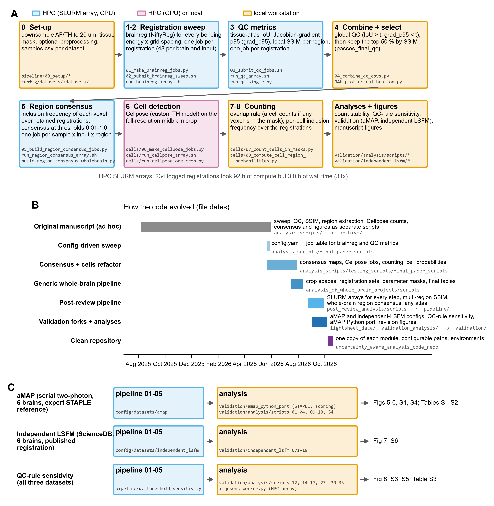

# Uncertainty-aware atlas registration for whole-brain LSFM

This repository holds the code for *Counting cells with confidence: uncertainty-aware atlas registration for whole-brain LSFM*. The method has four steps:
1. Run a parameter sweep of atlas registrations (brainreg) on an HPC cluster.
2. Remove clear failures with global quality control (tissue–atlas IoU and deformation).
3. Rank the remaining registrations by local structural similarity (SSIM) in the region of interest.
4. Combine the retained registrations into an inclusion-frequency map and a consensus region.

Cells are then counted in the consensus region. Each cell keeps the fraction of registrations that include it, so the dependence of a count on registration choice is reported, not hidden.



## Repository layout
| Folder | Contents |
|---|---|
| `pipeline/` | The pipeline used for the post-review analyses, steps 00–08 (see table below). One copy of every module; HPC steps have SLURM submit and array scripts. |
| `pipeline/qc_threshold_sensitivity/` | Re-runs global QC, SSIM ranking and consensus over a grid of QC thresholds (HPC array). |
| `pipeline/cells/` | Cellpose cell detection, counting and per-cell inclusion frequency. |
| `config/datasets/` | Configuration of the three datasets: `original_lsfm` (this study), `amap` (aMAP serial two-photon validation) and `independent_lsfm` (ScienceDB VTA projectome). |
| `validation/amap_python_port/` | Python re-implementation of the aMAP validation workflow (STAPLE expert consensus, Dice scoring), with tests. |
| `validation/amap_staple_reference/` | Building the STAPLE reference volumes for the aMAP brains. |
| `validation/analysis/` | All validation and revision analyses (aMAP, original LSFM, QC-rule sensitivity) and manuscript figures. |
| `validation/independent_lsfm/` | Comparison with the published registrations of the independent LSFM dataset. ("gt" in file names = the published, automated registration; the registration image of this single-colour dataset is the marker channel.) |
| `figures/` | The scripts for the final manuscript figures and supplementary figures (Figs. 2–6, S1–S3, S5, S6), the supplementary tables (`make_supplementary_tables.py`) and the Supplementary Information document (`make_docx.py`). |
| `tools/` | Data deposit. To rebuild it from the pipeline outputs, run `build_data_release.py` (intermediate assembly), then `restructure_release_v2.py` (published layout: per brain, numbered pipeline steps, coronal 20 µm images, essential tables). `verify_release.py` checks the deposit end to end against the pipeline outputs (vote cache, analysis tables). |
| `archive/` | The original-manuscript scripts that produced the published counts, kept unchanged apart from paths, plus the first config-driven version. Not needed to run the pipeline. |
| `docs/` | Pipeline chart, figure-to-script map, HPC notes, script history. |
| `environment/` | Conda environments: `brainreg_hpc.yml` (HPC) and `analysis.yml` (workstation), with full package lists. |

## Pipeline steps
| Step | Script(s) | Where |
|---|---|---|
| 00 set-up | `pipeline/00_setup/` (downsampling to 20 µm, tissue masks, preprocessing, samples table) | local |
| 01–02 registration sweep | `01_make_brainreg_jobs.py`, `02_submit_brainreg_sweep*.sh`, `run_brainreg_array.sh` | HPC array (1 job per registration) |
| 03 QC metrics | `03_submit_qc_jobs*.sh`, `run_qc_array*.sh`, `run_qc_single.py`, `03_compute_qc_metrics.py` | HPC array |
| 04 combine and select | `04_combine_qc_csvs.py`, `04b_plot_qc_calibration.py` | local |
| 05 region consensus | `05_build_region_consensus_jobs.py`, `05_submit_region_consensus_sweep*.sh`, `run_region_consensus_array*.sh`, `build_region_consensus_wholebrain.py` | HPC array (1 job per sample × input × region) |
| 06 cell detection | `cells/06_make_cellpose_jobs.py`, `cells/06_submit_cellpose_jobs.sh`, `cells/run_cellpose_array.sh`, `cells/run_cellpose_one_crop.py` | HPC (GPU) or local |
| 07–08 counting | `cells/07_count_cells_in_masks.py`, `cells/08_compute_cell_region_probabilities.py` | local |

## Set-up
1. Create the environments:
   ```
   conda env create -f environment/brainreg_hpc.yml
   conda env create -f environment/analysis.yml
   ```
2. Tell the code where your data are. Scripts write storage paths with placeholders (`<IMAGING>`, `<SCRATCH>`, `<DATA>`), which `uaa_paths.py` resolves.
   - **Python:** copy `config/local_paths.example.yaml` to `config/local_paths.yaml` and edit it, or set `UAA_IMAGING_ROOT`, `UAA_SCRATCH` and `UAA_DATA_ROOT`.
   - **SLURM scripts:** these read `IMAGING_ROOT`, `SCRATCH` and `CONDA_ENV` from the environment.
3. Make a project folder for your dataset:
   - copy `config/datasets/<dataset>/config/` into it;
   - edit `config.yaml` (atlas, parameter grid, QC thresholds, region IDs) and the samples table;
   - set `PROJECT_DIR` to this folder when submitting jobs.

4. For the aMAP validation, clone https://github.com/SainsburyWellcomeCentre/aMAP_validation (with its `data/` folder and the downscaled brains) and set `AMAP_VALIDATION_ROOT` to the clone.

See `docs/running_on_hpc.md` for the order of commands.

**Tests:** `python -m unittest discover -s tests` and, for the aMAP port, `python -m unittest discover -s tests -t .` inside `validation/amap_python_port` (the aMAP port tests need `AMAP_VALIDATION_ROOT`).

## Reproducing the manuscript
- **Data:** the registration-level data for the five LSFM brains are deposited at <Zenodo DOI>; set `UAA_DATA_ROOT` to the downloaded folder.
- **Public datasets:** the aMAP validation dataset and the ScienceDB VTA projectome are public and are cited in the manuscript.
- **Figures and tables:** `docs/figure_to_script.md` lists the script that makes each figure and table.

## Notes
- **brainreg version.** All registrations used brainreg 1.0.10 (NiftyReg backend), as recorded in the run logs; the configs state this version.
- **Cellpose model.** The counts in the manuscript used the custom model `CP_epochs500_lr0.1_SGD_True_wd_1e-05` (Cellpose 2.x), which is included in the data deposit.
- **Two code generations.** The original-manuscript counts were produced by the scripts in `archive/original_manuscript_scripts`. The post-review analyses and validations use `pipeline/` and `validation/`. `docs/script_history.md` explains how the two relate.

## Licence and citation
- **Code:** see `LICENSE`.
- **aMAP port:** `validation/amap_python_port` is derived from the aMAP validation code of Niedworok et al. (2016), released under CC0 (`validation/amap_python_port/LICENSE_aMAP_original`).
- **Citation:** please cite the manuscript (see `CITATION.cff`).
